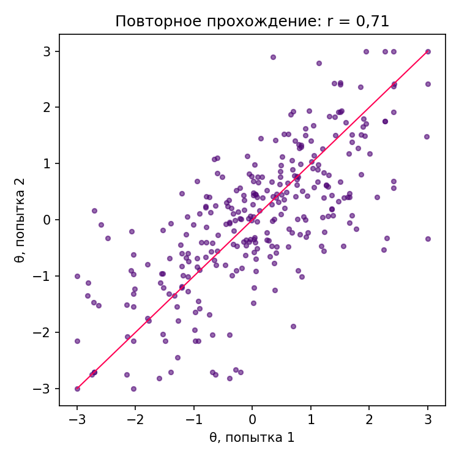
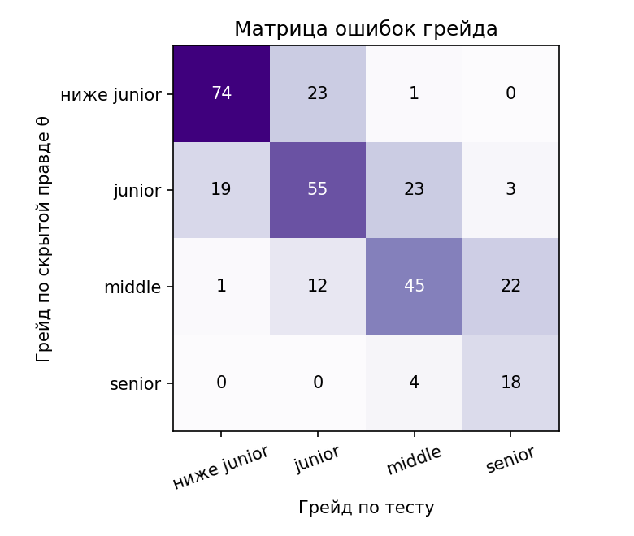
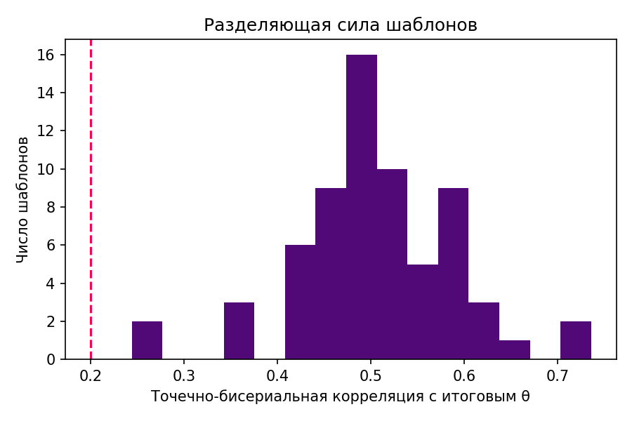
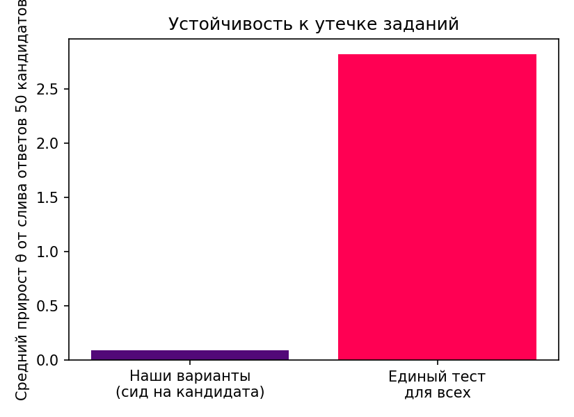
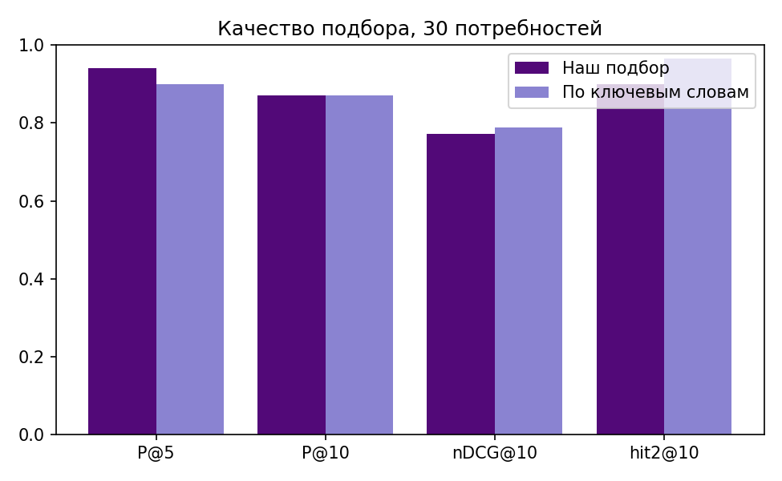

# Результаты валидации

Ядро: **real (backend/app/services)**
Сгенерировано: `python -X utf8 validation/run_all.py`, данные seed = 42, 300 кандидатов, 30 потребностей.

## A. Тестирование

### A1. Повторное прохождение (test-retest)

- Совпадение грейда по тесту между двумя попытками (разные варианты заданий): **56,3 %**
- Совпадение решения «подтверждён / не подтверждён»: **74,3 %**
- Корреляция Пирсона θ₁ и θ₂: **0,71**

### A2. Точность против скрытой правды

- Точное совпадение грейда: **64,0 %**; ошибка больше чем на ступень: **1,7 %**
- Решение о подтверждении заявленного грейда верно: **80,3 %**
- Средняя абсолютная ошибка θ: **0,52**

### A3. Разделяющая сила шаблонов

- Шаблонов с ≥ 10 ответами: 66; медиана точечно-бисериальной корреляции: **0,50**
- Корреляция заявленной и уточнённой сложности b: **0,96**
- На доработку (корреляция < 0,2): **0**

| Шаблон | Ответов | r_pb | Доля верных, нижняя треть | Верхняя треть | b заявл. | b уточн. |
|---|---|---|---|---|---|---|
| bas.autopilot.modes | 24 | 0,24 | 0,38 | 0,38 | -1,10 | -1,01 |
| bas.mavlink.link_budget | 18 | 0,26 | 0,17 | 0,50 | 1,50 | 2,43 |
| frontend.web.debounce | 87 | 0,35 | 0,28 | 0,52 | 1,10 | 1,34 |
| backend.python.list_alias | 58 | 0,35 | 0,16 | 0,53 | 1,50 | 2,04 |
| backend.http.cache_codes | 125 | 0,36 | 0,27 | 0,76 | 0,60 | 0,49 |
| frontend.js.event_loop | 89 | 0,41 | 0,14 | 0,59 | 1,20 | 1,68 |
| backend.sql.isolation | 57 | 0,42 | 0,21 | 0,68 | 1,60 | 1,54 |
| backend.python.loop_mod | 149 | 0,42 | 0,39 | 0,84 | -0,90 | -1,12 |
| bas.mavlink.frame_size | 22 | 0,42 | 0,29 | 0,86 | 1,20 | 0,71 |
| frontend.css.specificity | 162 | 0,42 | 0,22 | 0,69 | 0,30 | 0,16 |
| backend.http.codes_basic | 79 | 0,44 | 0,42 | 0,85 | -1,40 | -1,66 |
| frontend.css.a11y | 55 | 0,44 | 0,17 | 0,61 | 1,50 | 1,71 |
| frontend.css.flex_grow | 111 | 0,45 | 0,22 | 0,65 | 0,80 | 1,03 |
| backend.sql.left_join | 148 | 0,45 | 0,14 | 0,65 | 0,10 | 0,24 |
| frontend.js.map_parseint | 60 | 0,45 | 0,20 | 0,60 | 1,60 | 2,06 |

_Показаны 15 шаблонов с наименьшей корреляцией; полный список — `results.json`._

### A4. Устойчивость к утечке

- Доля пар кандидатов с одинаковым вариантом на одном шаблоне: **0,1 %**
- Слив ответов 50 других кандидатов: средний прирост θ **0,085**, максимум 0,84, прирост хоть какой-то у 17,0 % из 100 «сливщиков»
- Для сравнения, единый тест для всех: средний прирост θ **2,82**

### A5. Согласие разметчиков

- Пар: 200; совпадение: **77,5 %**; каппа Коэна: **0,64**; квадратично-взвешенная каппа: **0,78**

| На 10 потребностях × 20 карточек | P@5 | P@10 | nDCG@10 |
|---|---|---|---|
| Наш подбор (соседние грейды) против независимой разметки | 0,98 | 0,85 | 0,81 |
| Ключевые слова против независимой разметки | 0,94 | 0,91 | 0,94 |
| Наш подбор против разметки по скрытой правде | 0,98 | 0,85 | 0,75 |

## B. Подбор

| Метод | P@5 | P@10 | nDCG@10 | Есть «2» в топ-10 |
|---|---|---|---|---|
| Наш подбор (грейд строго) | 0,94 | 0,87 | 0,77 | 90,0 % |
| Наш подбор (соседние грейды) | 0,97 | 0,94 | 0,72 | 96,7 % |
| По ключевым словам | 0,90 | 0,87 | 0,79 | 96,7 % |

### Кандидаты без истории ФСП

- Доля без ФСП в топ-10: **53,6 %** при доле в базе 60,1 %
- Сильный кандидат без ФСП (разметка 2) выше слабого с ФСП (разметка 0): **91,4 %** из 3165 сравнений
- Пример: потребность 1 — кандидат 54 без ФСП на 25-м месте, кандидат 47 с ФСП (не подходит) на 36-м.

## C. Производительность

- `rank` на 300 кандидатах: **0,6 мс**; на 3000: **9,3 мс** (медиана из 20 прогонов)
